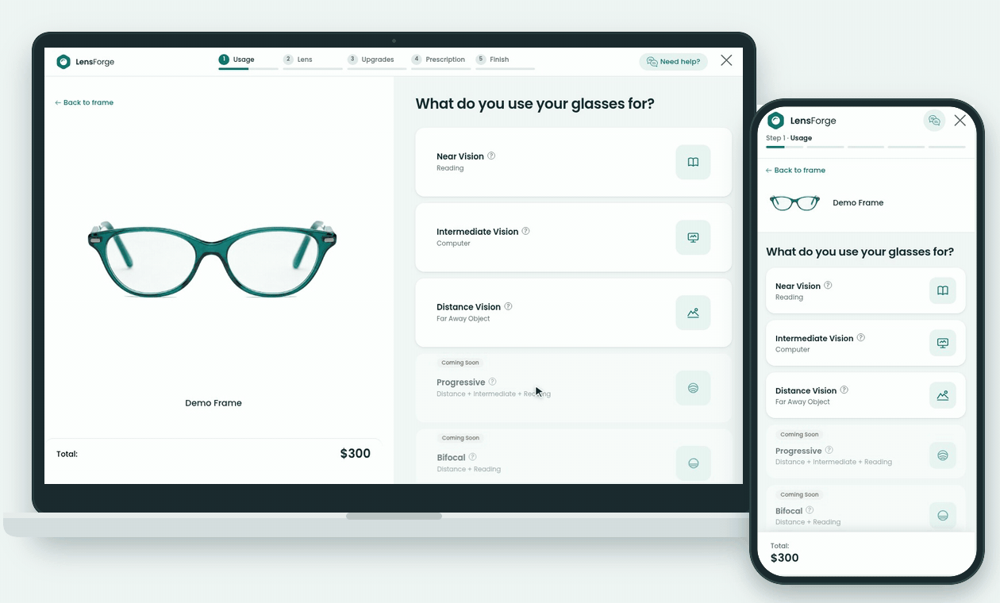

<p align="center">
  
</p>

<p align="center">
  An embeddable lens configurator for eyewear stores.<br />
  The shopper picks a frame, LensForge walks them through lenses, coatings and prescription, and hands the finished configuration back to the store.
</p>



<p align="center">
  Separate recordings: <a href="public/lensforge-flow.gif">desktop</a> · <a href="public/lensforge-flow-mobile.gif">phone</a>
</p>

## What it does

LensForge is a React widget that a store drops onto a product page. The host page passes a frame id; LensForge loads the frame, prices every lens option on the fly and, at the end, emits a single `lensforge:add-to-cart` event with everything the store needs to place the order.

- **Step-by-step flow** — usage, lens type, lens options, coatings, prescription and a final review, with a progress bar in the header.
- **Every common path** — non-prescription, distance, intermediate and near vision, plus ready-reader lens power selection.
- **Photochromic and sunglasses lenses** — color selection with a live lens preview, an indoor/outdoor slider, tint levels, polarized and mirrored options.
- **Coating upgrades** with live price updates and info popups.
- **Prescription input** — fill it out online, upload a photo, use a saved one or send it later.
- **Live pricing** on every step, including product special prices.
- **Responsive layout** — two columns on desktop, a single column with a sticky total and “Next” bar on tablets and phones.
- **Works without a backend** — a full mock API ships with the demo.

## Quick start

```bash
npm ci
npm start
```

`npm start` runs the widget against the mock API. Open `http://localhost:3000`: the demo page loads the sample frame `demo-frame` from `public/demo/products/`.

| Command | What it does |
|---|---|
| `npm start` | Dev server with the mock API |
| `npm test` | Jest + Testing Library |
| `npm run lint` | ESLint, fails on any warning |
| `npm run typecheck` | `tsc --noEmit` |
| `npm run build` | Production build using `.env.production` |

## Embedding

The host page renders one container. LensForge reads its attributes and mounts inside it.

```html
<div
  id="lensforge"
  data-product-id="my-frame-id"
  data-upload-token="token-from-your-backend"
></div>
<link rel="stylesheet" href="https://cdn.example.com/lensforge/static/css/main.css" />
<script src="https://cdn.example.com/lensforge/static/js/main.js"></script>
```

- `data-product-id` — the frame to configure. If it is missing, LensForge falls back to `?productId=` in the page URL, then to `REACT_APP_DEFAULT_PRODUCT_ID`.
- `data-upload-token` — sent with prescription uploads in `http` mode.
- The build keeps stable file names (`static/js/main.js`, `static/css/main.css`) via `config-overrides.js`, so the embed snippet does not change between releases.

### Host events

LensForge does not navigate or touch the store's cart by itself. It reports what the shopper did, and the host page decides what happens next. All events bubble from `#lensforge` as `CustomEvent`s.

| Event | Fired by | `detail` |
|---|---|---|
| `lensforge:close` | Close button or “Back to frame” | — |
| `lensforge:help` | “Need help?” button | — |
| `lensforge:add-to-cart` | “Add To Cart” on the review screen | `{ productId, values, totalPrice, prescription }` |

`prescription` is `{ values, fileUrl, lensPower }`; `values` is the same payload that is sent to the pricing endpoint.

```html
<script>
  const widget = document.getElementById("lensforge");

  widget.addEventListener("lensforge:add-to-cart", (event) => {
    addToCart(event.detail);
  });

  widget.addEventListener("lensforge:close", () => {
    history.back();
  });
</script>
```

The demo page (`public/index.html`) is a working example: closing collapses the widget into a “Back to lens selection” card, “Add To Cart” does the same with an animated “Added to cart” check, and “Need help?” shows a short demo notice.

## Configuration

All environment access lives in `src/api/config.ts`. Create React App exposes only `REACT_APP_*` variables to the browser.

| Variable | Default | Description |
|---|---|---|
| `REACT_APP_API_MODE` | `mock` | `mock` uses the bundled demo data, `http` calls the REST API |
| `REACT_APP_API_URL` | `http://localhost:8000/` in development, `/` in production | Base URL of the REST API |
| `REACT_APP_BASE_URL` | `/` | Where static assets (`images/`, `demo/`) are served from |
| `REACT_APP_DEFAULT_PRODUCT_ID` | `demo-frame` | Fallback frame id |
| `PUBLIC_URL` | `/` | CRA public path for the build |

`.env.development` and `.env.test` use the mock API; `.env.production` switches to `http`.

### REST API (`http` mode)

| Method | Path | Purpose |
|---|---|---|
| `GET` | `/products/:productId` | Frame title, image, price and currency |
| `POST` | `/lens-values` | Prices for the current selection and the running total |
| `POST` | `/prescriptions` | Prescription photo upload, authorized with `data-upload-token` |

The mock implementation in `src/api/mock/` follows the same contract, and `src/api/mock/fixtures/valuesResponse.example.json` shows a full `/lens-values` response.

## Project structure

```
src/
  api/          HTTP and mock API clients, environment config
  components/   Screens, panels, forms, modals, price and steps
  config/       Screens, panels, steps, colors and forms — the flow is data-driven
  helpers/      Price formatting, host events, request building
  store/        Redux Toolkit slices
  __antd.scss   Base widget styles
  theme.scss    Visual theme and responsive layout
public/
  index.html    Demo host page
  demo/         Sample frame
  images/       Lens, coating and logo assets
  *.gif         Walkthrough recordings used in this README
```

## Tech stack

React 18, TypeScript, Redux Toolkit, Ant Design 5, Formik + Yup, Sass, Create React App with `react-app-rewired`, Jest and Testing Library.

## License

[MIT](LICENSE)
